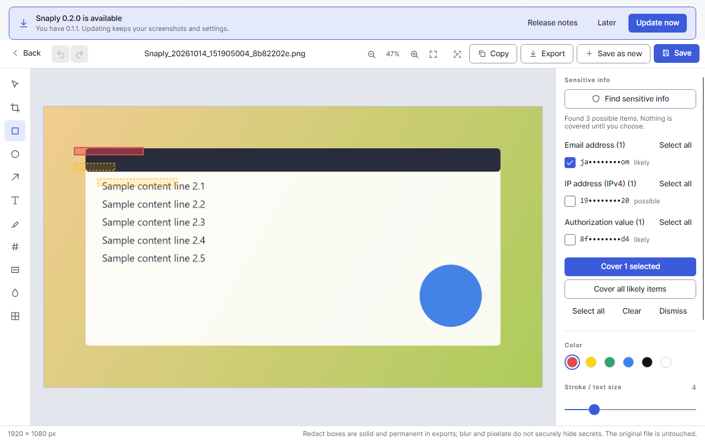

# Smart redaction

## Workflow

1. Open a screenshot in the editor and click **Find sensitive info** (right panel). This needs OCR language data (see the README).
2. Snaply reads the original image locally and shows suggestions as dashed boxes on the image and as a list grouped by type. Values are shown partly masked.
3. Tick what to cover (per item, per type with **Select all**, or click a box on the image with the Select tool). Nothing is pre-selected.
4. **Cover selected** (or **Cover all likely items**) adds solid black boxes in one undoable step.
5. **Save redacted copy** writes a new image. You can also use Copy or Export: every output path flattens the boxes.

Missed something? Use the **Redact** tool (`X`) to draw your own box.

## What is detected

Email addresses, phone numbers, IPv4/IPv6 addresses, JWTs, `Bearer`/`Basic` values and `Authorization:` values, common API-key and token formats (AWS, GitHub, GitLab, Slack, Stripe, Google, npm, SendGrid, `sk-…`), labelled secrets (`api_key=…`, `password: …`), sensitive URL parameters (only the value is covered), payment-card numbers (Luhn-checked) and IBANs (checksum-checked). UUIDs can be enabled in Settings → Redaction (off by default because they are rarely secret). Each type can be turned off there.

## What "irreversible" means here

- A redaction box is always drawn fully opaque, snapped outward to whole pixels, so no edge pixel keeps a trace of the original.
- Copy, Export, Save as new and Save redacted copy render a single flattened image. The covered pixels are not in the file.
- The redacted copy has **no OCR text** and **no editable annotation document**, so nothing can be recovered by search or by opening the edit layers. It is tagged `Redacted`.
- The **original screenshot is kept as it was** (still unredacted, with its text). The editor can delete it after saving the copy; this is off by default and always asks first.
- Blur and Pixelate stay available for cosmetic use but do not securely hide secrets.

## Limits

- Detection depends on OCR. Small, low-contrast, stylised or non-English text can be missed or misread, and rules are heuristics, so false negatives and false positives happen. Always check the result before sharing.
- A token that OCR splits into several lines without a break may be only partly found.
- Names, postal addresses, faces, QR codes and handwriting are not detected.
- Real-desktop accuracy with real OCR output has not been measured yet; the rules are tested against synthetic word layouts.
